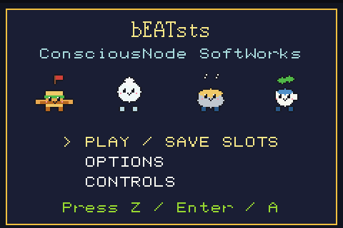
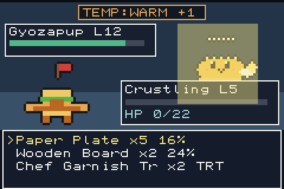
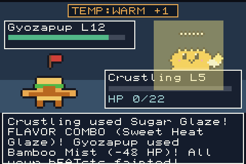
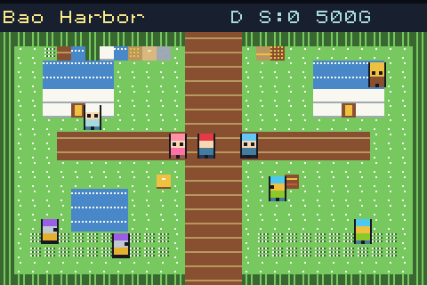
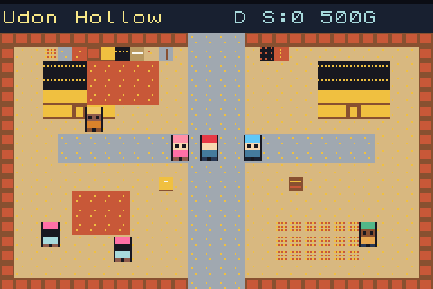
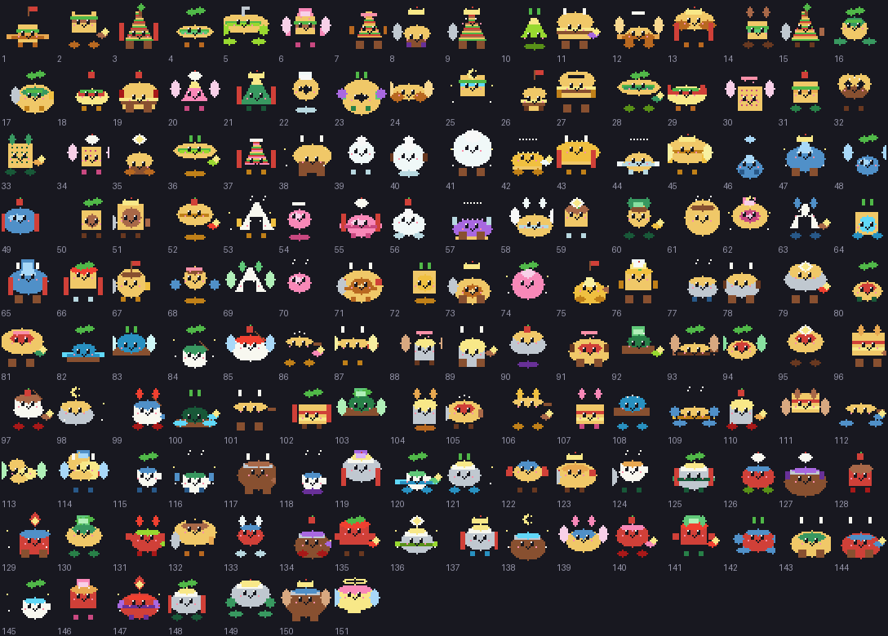

# bEATsts

**A monster-collecting RPG where the monsters are food.** Sandwiches, dumplings, noodles and soup: 151 of them. Unhinged, but wholesome.

**[Play it in your browser](https://consciousnode.github.io/bEATsts/beatsts.html)** · [Landing page](https://consciousnode.github.io/bEATsts/)

It's one self-contained HTML file, with no dependencies, no network and no accounts. Every sprite, tile, note and line of text is generated or written inside the file. It runs offline in any modern browser, on a keyboard or a phone.

## The game

You're a young cook-trainer in **Pantrylia**. Wild bEATsts roam the tall grass, and you befriend them by **plating** them. You don't throw anything: you set a place at the table, and if a bEATst likes the setting, it sits down and joins you. Fancier place settings work better, from a Paper Plate up to a Royal Banquet Setting, and the join chance shows on each one.

- **4 regions,** one per food family: Breadlands, Steambay, Noodleridge and Brothbasin. Each has its own towns, routes, special area, music and wildlife.
- **8 kitchens** with head chefs and Kitchen Seals, Rival Saffron, the Grand Tasting Hall and its champion, and a postgame area.
- **12 cooking types,** 124 moves and Recipe Cards to teach them.
- **Kitchen Temp:** every move heats or cools the kitchen, which boosts some types and weakens others.
- **Flavor combos:** complementary types used back to back deal bonus damage and heal a little.
- **Quests and secrets,** including one more bEATst than the bEATdex admits to.
- **3 save slots** with player names, plus Export / Import save as a file.

| | |
|---|---|
|  |  |
|  |  |

## Controls

| Button | Keyboard |
|---|---|
| Move | Arrow keys / WASD / on-screen D-pad |
| A (confirm, talk) | Z / Enter / Space |
| B (back) | X / Esc / Backspace |
| START (menu) | M |
| SELECT | N / Tab |

## Built like a Game Boy Advance game

The game is shaped so a real GBA port is a translation, not a redesign:
- a 240 × 160 screen, 8 × 8 tiles, and 16-color palettes from 15-bit color;
- a chiptune engine with two pulse channels, a wave channel and a noise channel;
- text in the studio's own bitmap fonts, ConsciousNode Sans 8 × 8 and CNSW Serif 8 × 16 (from [CNSW-Fonts](https://github.com/ConsciousNode/CNSW-Fonts));
- data formats documented in [DATA.md](DATA.md).

## How it was made

bEATsts is a ConsciousNode SoftWorks one-shot. Kham and Kehai wrote the spec, Hydrogen built it with full creative control, and the studio audits every delivery:
- [REPORT.md](REPORT.md): Hydrogen's build report and test output.
- [AUDIT.md](AUDIT.md): our audit of version 2, and [AUDIT-v1.md](AUDIT-v1.md) for version 1. They cover what we checked in a real browser, what holds up, and what's still open.
- `tests/run-all.js`: the game's own test suite (`node tests/run-all.js`; the browser tests need Chromium and a matching ChromeDriver via `CHROME_BIN` / `CHROMEDRIVER`).

### Known issues (v2)
- ~~The screen went black after every battle win (sound kept playing).~~ Fixed 2026-11-14.
- One tap of an arrow key moves two tiles.
- The Tour of Four Palates quest can't be completed.
- In battle, the player's status box can cover the bottom of a wild bEATst's sprite.

Version 2.1 is in the works: hand-designed maps with enterable buildings, real dungeons, a rival arc, and a suspiciously polite food-review syndicate.

## License

MIT, © 2026 ConsciousNode. See [LICENSE](LICENSE).
